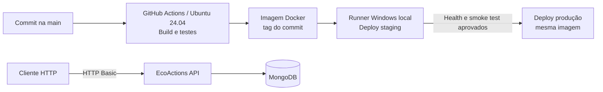
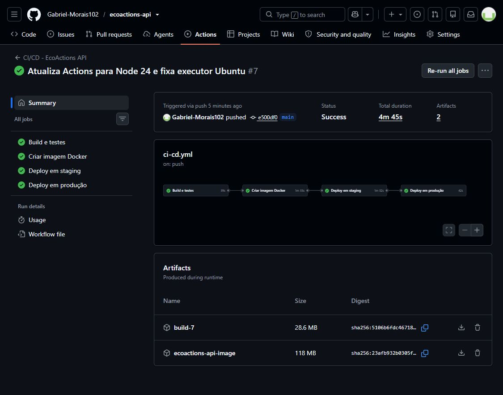
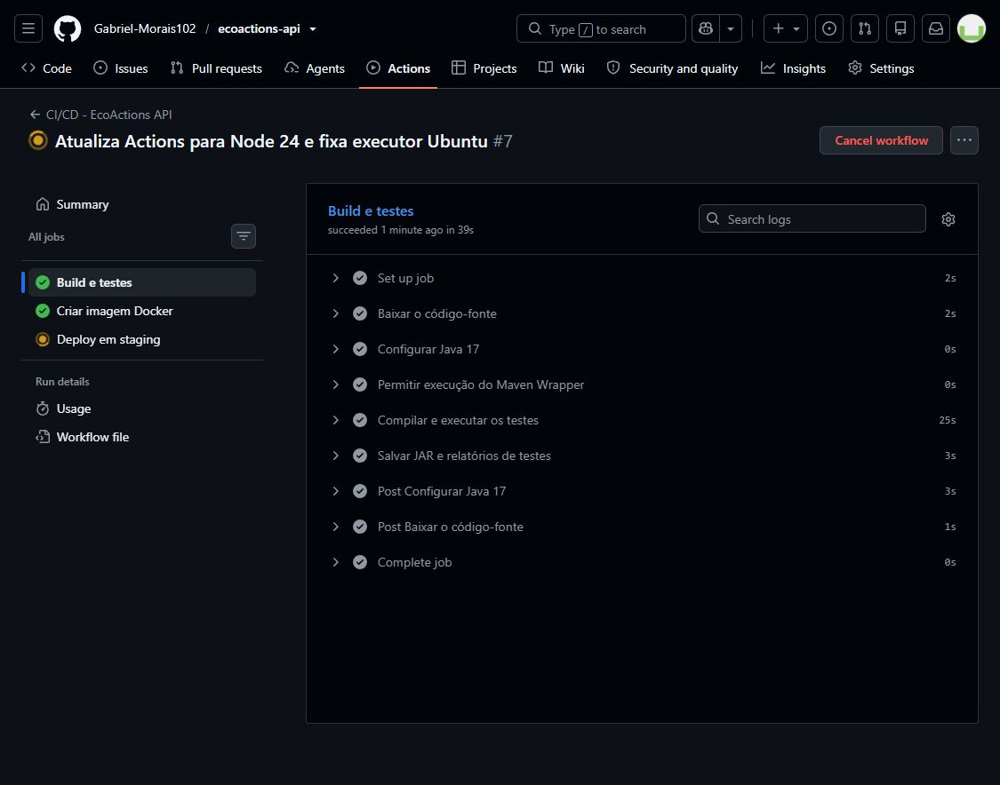
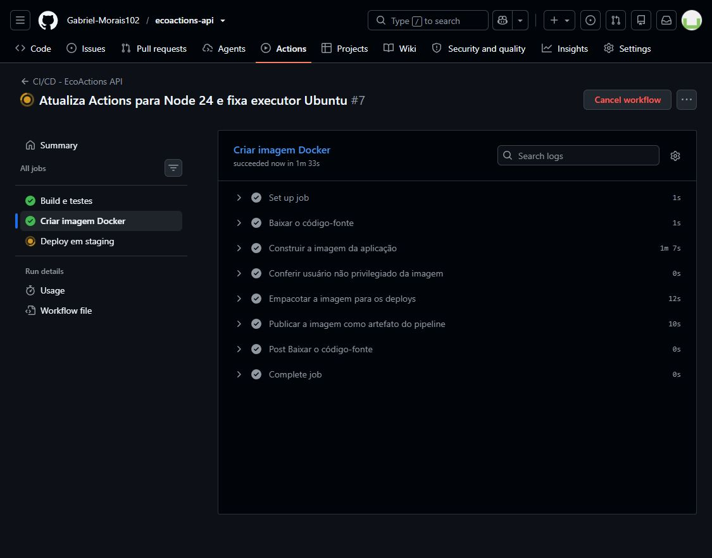
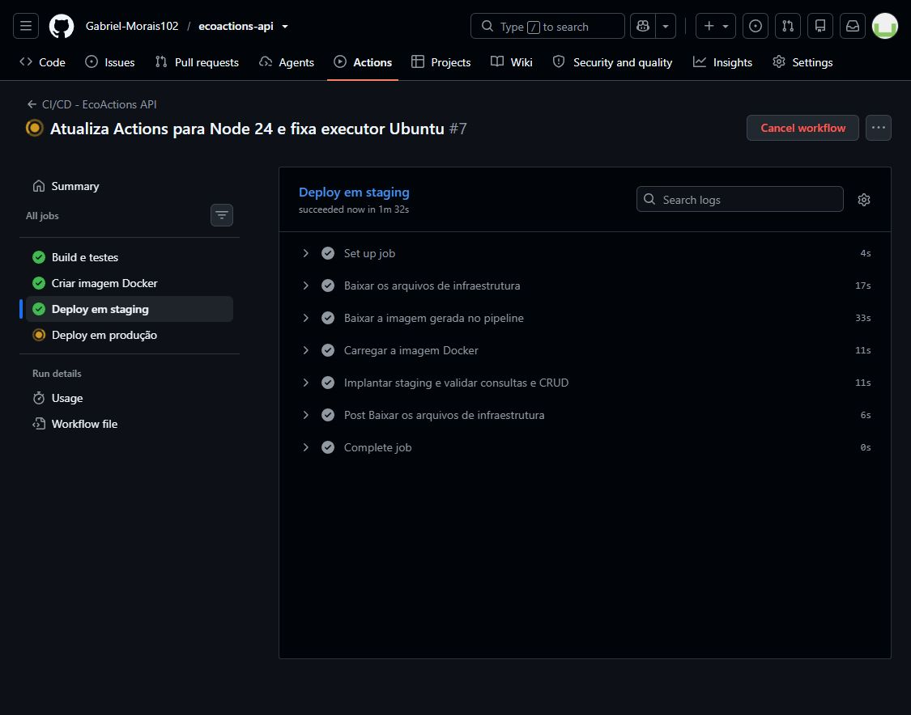
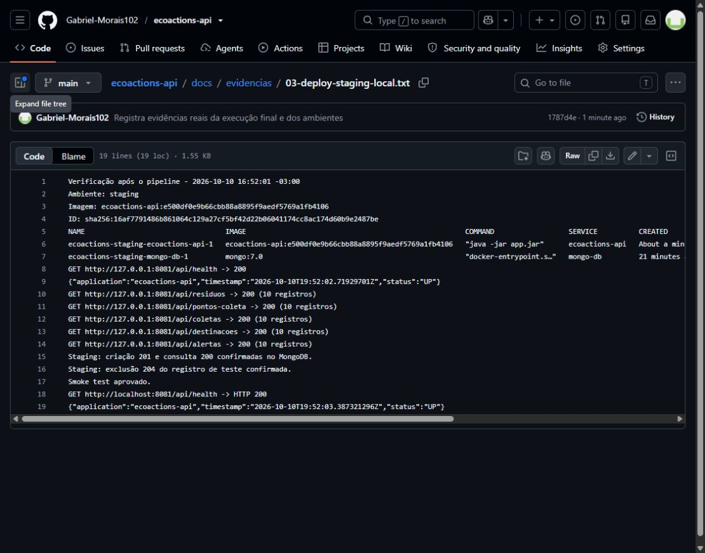
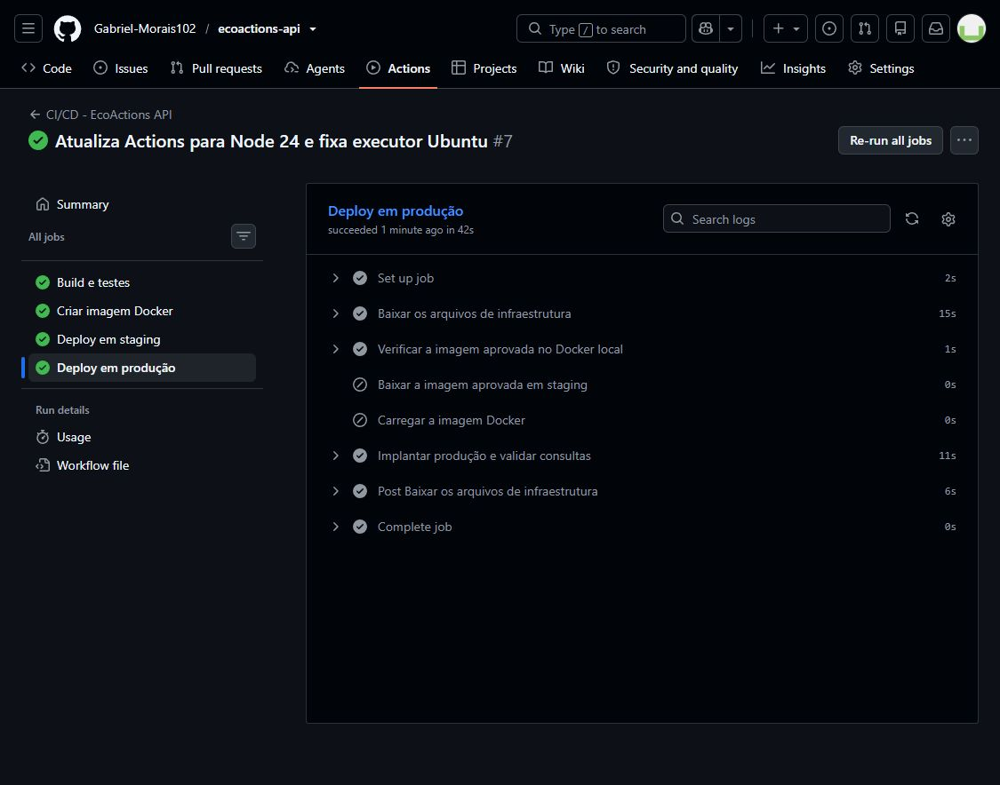
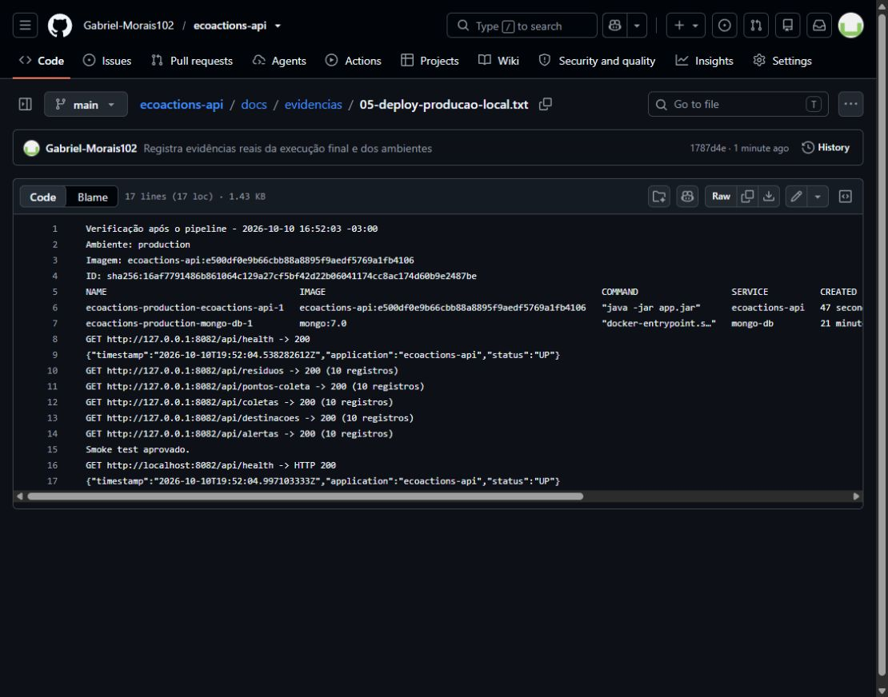

# Projeto — Cidades ESG Inteligentes | EcoActions API

API REST para apoiar a gestão de resíduos, pontos de coleta, coletas, destinações
e alertas ambientais. O projeto aplica DevOps com build, testes, containerização
e deploy automatizado em dois ambientes.

**Integrante:** Gabriel Elias Lopes de Morais — **RM:** 566281 — **Turma:** 2TDSOD

**Repositório:** [Gabriel-Morais102/ecoactions-api](https://github.com/Gabriel-Morais102/ecoactions-api)

## Sobre o projeto e arquitetura

O EcoActions registra o fluxo do descarte até a destinação final e permite
acompanhar a capacidade dos pontos de coleta. Usa Spring Boot, autenticação
HTTP Basic e MongoDB. Na criação de um volume novo, o banco recebe collections,
índices e uma carga de demonstração com 10 documentos por collection.



Os ambientes são projetos Docker Compose independentes no host Windows. Cada
um tem API, MongoDB, rede e volume próprios. Os serviços continuam ativos depois
do pipeline, enquanto o computador e o Docker Desktop estiverem ligados. Esta
entrega simula produção em um host local, sem URL pública ou nuvem.

## Como executar localmente com Docker

### Pré-requisitos

- Docker Desktop em modo de contêineres Linux, com Docker Compose v2;
- portas `8080` e `27017` disponíveis para o ambiente local;
- PowerShell 7 (`pwsh`) para os scripts de deploy e smoke test;
- Java 17 somente para executar Maven fora do Docker.

Na raiz do projeto, copie o arquivo de ambiente:

```powershell
Copy-Item .env.example .env
```

Em Linux ou macOS, use `cp .env.example .env`. Edite o arquivo e substitua todas
as senhas de exemplo. Para senhas com `$` ou `#`, use aspas simples no `.env`,
conforme o modelo. As credenciais são campos separados de conexão, sem
concatenação em uma URI MongoDB.

Construa a aplicação e espere pelos health checks:

```bash
docker compose up --detach --build --wait --wait-timeout 180
docker compose ps
```

O MongoDB inicia primeiro. A API só inicia depois de o banco ficar saudável.
O endpoint público consulta o MongoDB antes de responder:

```bash
curl http://localhost:8080/api/health
```

Uma resposta HTTP `200` contém `status: "UP"`, `application: "ecoactions-api"`
e um timestamp. Se a conexão com o banco falhar, retorna HTTP `503` com
`status: "DOWN"`.

Para consultar dados, use o usuário configurado no `.env`. O comando solicita
a senha sem gravá-la na linha de comando:

```bash
curl -u admin http://localhost:8080/api/residuos
```

No Windows PowerShell 5.1, use `curl.exe` para evitar o alias de
`Invoke-WebRequest`. Validação funcional completa com PowerShell 7:

```powershell
pwsh -File scripts/smoke-test.ps1 -EnvFile .env -CheckCrud
```

Para parar e remover os contêineres preservando os dados:

```bash
docker compose down
```

`docker compose down --volumes` também apaga o banco. O pipeline não usa esse
comando. Para volumes da versão anterior, siga a
[migração sem perda de dados](deploy/README.md#migração-de-volumes-existentes).

## Ambientes de staging e produção

| Ambiente | API | MongoDB no host | Projeto Compose | Banco |
| --- | --- | --- | --- | --- |
| Local | `localhost:8080` | `127.0.0.1:27017` | `ecoactions-local` | `ecoactions` |
| Staging | `localhost:8081` | `127.0.0.1:27018` | `ecoactions-staging` | `ecoactions_staging` |
| Produção | `localhost:8082` | `127.0.0.1:27019` | `ecoactions-production` | `ecoactions_production` |

As configurações persistentes ficam fora do checkout temporário do runner,
sob o diretório absoluto definido por `ECOACTIONS_DEPLOY_ROOT`:

```text
.deployment/
├── staging/
│   └── .env
└── production/
    └── .env
```

Os `.env` ficam no host. A pasta `.deployment` é ignorada pelo Git e pelo
contexto Docker. O script copia Compose e scripts para cada ambiente, mantendo
os caminhos montados independentes do checkout do runner.

Prepare os arquivos conforme o [guia de deploy](deploy/README.md). Para implantar
manualmente a mesma imagem nos dois ambientes:

```powershell
docker build --tag ecoactions-api:local .
pwsh -File scripts/deploy.ps1 -Environment staging -Image ecoactions-api:local
pwsh -File scripts/deploy.ps1 -Environment production -Image ecoactions-api:local
```

O deploy automático usa a imagem produzida no GitHub Actions. O deploy local usa
o mesmo script e precisa de `ECOACTIONS_DEPLOY_ROOT` definido no processo.

## Pipeline CI/CD

Configuração: [`.github/workflows/ci-cd.yml`](.github/workflows/ci-cd.yml).

| Job | Executor | Etapas |
| --- | --- | --- |
| `build-and-test` | GitHub, Ubuntu 24.04 | Java 17, `clean verify`, JAR e relatórios |
| `docker-image` | GitHub, Ubuntu 24.04 | Build multi-stage, verificação do usuário e publicação da imagem como artefato |
| `deploy-staging` | Runner Windows local | Carrega a imagem, aplica Compose, aguarda health, consulta dados e testa criação/leitura/exclusão |
| `deploy-production` | Runner Windows local | Implanta a imagem aprovada em staging e valida health e consultas autenticadas |

O pipeline inicia em pull requests para `main`, pushes em `main` e execução
manual. Pull requests executam somente build, testes e imagem em runners
hospedados. Os deploys exigem a branch `main` e ocorrem em sequência. Uma
execução manual em outra branch não implanta os ambientes.

Pushes que alteram somente `README.md`, `docs/**`, `documentacao/**` ou
`deploy/README.md` não iniciam outra execução. A concorrência é controlada
para que um novo push não interrompa a execução em andamento.

### Imagem e promoção

A imagem recebe a tag `ecoactions-api:<SHA-do-commit>`, é salva com `docker save`
e distribuída como artefato com nível de compressão 6. Staging baixa o artefato
e carrega a imagem com `docker load`.

Produção depende do sucesso de staging e reutiliza a imagem da mesma tag já
presente no Docker do host. Se a imagem não estiver disponível, o job baixa e
carrega o artefato da execução. Não há novo build durante a promoção.

A compressão reduz o volume transferido pela rede, e o reaproveitamento da
imagem evita um segundo download no mesmo host. Os jobs de deploy têm limite
de 30 minutos para acomodar a transferência sem encerrar os serviços.

O JAR e os relatórios Surefire ficam disponíveis por sete dias; o arquivo da
imagem, por um dia. O banco de cada ambiente fica em volume persistente no host
e não depende da retenção desses artefatos.

### Runner e credenciais

O runner de deploy precisa dos rótulos `self-hosted`, `Windows`, `X64` e
`ecoactions-deploy`, PowerShell 7 e acesso ao Docker Desktop. Configure
`ECOACTIONS_DEPLOY_ROOT` antes de iniciá-lo. Veja o [guia de deploy](deploy/README.md).
As versões das actions usadas exigem runner **2.327.1 ou superior**; o host
da entrega usa a versão **2.338.0**.

Os ambientes GitHub são `staging` e `production`. As senhas dos serviços ficam
somente nos `.env` do host; os scripts mascaram credenciais nos logs do Actions.
Essa configuração não exige senhas dos bancos cadastradas como GitHub Secrets.

### Verificação do deploy

[`scripts/deploy.ps1`](scripts/deploy.ps1) executa Compose com `--no-build` e
`--wait`, chama o smoke test e registra a imagem em `deployed-image.txt`.
Não encerra serviços nem remove volumes ao terminar.

[`scripts/smoke-test.ps1`](scripts/smoke-test.ps1) exige health conectado ao
MongoDB e faz consultas autenticadas às cinco áreas da API. Em staging, também
cria um resíduo, consulta o registro e o remove ao final. Em produção, faz
somente leituras.

## Testes automatizados

A suíte tem **33 testes automatizados**, usando JUnit 5, Mockito e Spring Test:

- inicialização e health, incluindo HTTP 503 quando o MongoDB está indisponível;
- autenticação, permissões USER/ADMIN e validação de requisições;
- respostas 400, 404, 409 e tratamento seguro de erros inesperados;
- regras de coletas, capacidade, alertas e exclusão de registros vinculados.

Os testes unitários simulam dependências; o smoke test complementa a suíte com
aplicação e MongoDB reais. O teste que provoca um erro inesperado registra um
`ERROR` proposital para validar a resposta HTTP 500 sem expor detalhes internos.
O resultado da suíte está no resumo `Tests run` e em `BUILD SUCCESS`.

Windows:

```powershell
.\mvnw.cmd --batch-mode --no-transfer-progress clean verify
```

Linux ou macOS, inclusive após descompactar o ZIP:

```bash
chmod +x mvnw
./mvnw --batch-mode --no-transfer-progress clean verify
```

Os relatórios ficam em `target/surefire-reports`.

## Containerização

### Dockerfile

```dockerfile
FROM eclipse-temurin:17-jdk-jammy AS build

WORKDIR /workspace

COPY mvnw .
COPY .mvn .mvn
COPY pom.xml .

RUN chmod +x mvnw && ./mvnw -B dependency:go-offline

COPY src src

RUN ./mvnw -B clean package -DskipTests

FROM eclipse-temurin:17-jre-jammy AS runtime

RUN apt-get update \
    && apt-get install -y --no-install-recommends curl \
    && rm -rf /var/lib/apt/lists/* \
    && groupadd --system spring \
    && useradd --system --gid spring spring

WORKDIR /app

COPY --from=build --chown=spring:spring \
    /workspace/target/ecoactions-api-0.0.1-SNAPSHOT.jar \
    app.jar

USER spring:spring

EXPOSE 8080

HEALTHCHECK --interval=30s --timeout=5s --start-period=30s --retries=3 \
    CMD curl --fail --silent --show-error --max-time 4 "http://localhost:${SERVER_PORT:-8080}/api/health" || exit 1

ENTRYPOINT ["java", "-jar", "app.jar"]
```

O build separa JDK/Maven do runtime com JRE, copia o `pom.xml` antes do código
para aproveitar o cache e executa como `spring:spring`. Os testes rodam no job
anterior à criação da imagem. O health check respeita `SERVER_PORT`.
O `.dockerignore` exclui credenciais, builds locais e documentação do contexto.

### Docker Compose e MongoDB

O [`docker-compose.yml`](docker-compose.yml) configura a rede `ecoactions-network`,
o volume `mongo-data`, variáveis de ambiente e health checks dos dois serviços.
O nome do projeto prefixa redes e volumes, isolando os ambientes.

O MongoDB publica a porta somente em `127.0.0.1`. Na rede Docker, a API usa
`mongo-db` e um usuário com `readWrite` apenas no banco do ambiente. As
credenciais administrativas são usadas na inicialização e migração, sem serem
fornecidas à API.

Volumes novos executam `docker/mongodb/init`. Volumes existentes precisam da
migração do usuário descrita no guia de deploy, sem apagar dados.

## Principais endpoints

| Método | Endpoint | Descrição | Acesso |
| --- | --- | --- | --- |
| `GET` | `/api/health` | Saúde da aplicação e conexão ao MongoDB | Público |
| `GET` | `/api/residuos` | Lista resíduos | USER ou ADMIN |
| `POST` | `/api/residuos` | Cadastra um resíduo | ADMIN |
| `PUT` | `/api/residuos/{id}` | Atualiza um resíduo | ADMIN |
| `DELETE` | `/api/residuos/{id}` | Remove um resíduo | ADMIN |
| `GET` | `/api/pontos-coleta` | Lista pontos de coleta | USER ou ADMIN |
| `GET` | `/api/coletas` | Lista coletas | USER ou ADMIN |
| `GET` | `/api/destinacoes` | Lista destinações | USER ou ADMIN |
| `GET` | `/api/alertas` | Lista alertas | USER ou ADMIN |
| `POST` | `/api/alertas/verificar-ponto/{id}` | Verifica alertas de um ponto | ADMIN |

As outras operações CRUD seguem o mesmo padrão: leitura para USER/ADMIN e
alteração para ADMIN. As senhas dos usuários HTTP Basic vêm do ambiente.

## Variáveis de ambiente

| Variável | Finalidade |
| --- | --- |
| `COMPOSE_PROJECT_NAME` | Identificação e isolamento do ambiente |
| `APP_IMAGE` | Imagem a implantar; o pipeline usa a tag do commit |
| `APP_PORT` / `SERVER_PORT` | Porta da API no host / dentro do contêiner |
| `MONGO_PORT` / `MONGO_DATABASE` | Porta local publicada / banco |
| `MONGO_ROOT_USERNAME` / `MONGO_ROOT_PASSWORD` | Administração e inicialização do banco |
| `MONGO_APP_USERNAME` / `MONGO_APP_PASSWORD` | Usuário da API no banco, com `readWrite` |
| `MONGODB_AUTO_INDEX_CREATION` | Criação automática de índices pelo Spring Data |
| `APP_ADMIN_USERNAME` / `APP_ADMIN_PASSWORD` | Usuário administrativo HTTP Basic |
| `APP_USER_USERNAME` / `APP_USER_PASSWORD` | Usuário de leitura HTTP Basic |
| `ECOACTIONS_DEPLOY_ROOT` | Diretório absoluto dos ambientes no host do runner |

O Compose traduz as variáveis do banco para `MONGODB_HOST`, `MONGODB_PORT`,
`MONGODB_DATABASE`, `MONGODB_USERNAME`, `MONGODB_PASSWORD` e
`MONGODB_AUTHENTICATION_DATABASE`, lidas pelo Spring Boot. Os campos separados
permitem caracteres especiais na senha sem codificação de URI.

## Prints do funcionamento

A [execução #7 do GitHub Actions](https://github.com/Gabriel-Morais102/ecoactions-api/actions/runs/38081156864) terminou com
**Success**, em **4m 45s**, para o commit
`e500df0e9b66cbb88a8895f9aedf5769a1fb4106`. Os quatro jobs foram concluídos: build e testes, imagem
Docker, staging e produção. A suíte executou **33 testes**, sem
falhas, erros ou testes ignorados.

### Pipeline e build





O [log de build e testes](docs/evidencias/01-build-e-testes.txt) preserva a
saída real do job no GitHub Actions. Os relatórios Surefire também ficam nos
artefatos do workflow.

### Imagem Docker



Staging e produção usam `ecoactions-api:e500df0e9b66cbb88a8895f9aedf5769a1fb4106`. Os metadados da
imagem estão em [02-imagem-docker.txt](docs/evidencias/02-imagem-docker.txt).

### Staging funcionando





Health UP, consultas autenticadas às 5 áreas e criação/leitura/exclusão de teste: 201/200/204. O
[registro de staging](docs/evidencias/03-deploy-staging-local.txt) contém a
saída real do smoke test e o estado dos contêineres após o deploy.

### Produção funcionando





Health UP e consultas autenticadas às 5 áreas, com 10 registros em cada resposta. O
[registro de produção](docs/evidencias/05-deploy-producao-local.txt) preserva
a validação após o término do pipeline.

As imagens dos smoke tests são capturas das páginas do GitHub que exibem os
logs reais, com identificação do ambiente, requisições e resultados. Os
serviços permanecem no host local; essas páginas são evidências da execução,
não endpoints públicos da API.

### Validações adicionais

- [Contrato HTTP e regras da API](docs/evidencias/08-validacao-api.txt):
  autenticação, validação, conflitos e preservação do saldo após rejeitar uma
  coleta inválida.
- [Indisponibilidade do MongoDB](docs/evidencias/09-health-indisponibilidade.txt):
  health retorna 503/DOWN durante a interrupção e volta a 200/UP após o reinício,
  sem recriar o volume.

## Tecnologias utilizadas

- Java 17 e Spring Boot 3.5.14;
- Spring Web, Spring Data MongoDB, Spring Security e Bean Validation;
- JUnit 5, Mockito e Spring Test;
- Maven Wrapper e MongoDB 7;
- Docker, Docker Compose, GitHub Actions e runner Windows;
- PowerShell 7, Bash e YAML.

## Documentação técnica

[`documentacao/EcoActions-Documentacao-Tecnica.pptx`](documentacao/EcoActions-Documentacao-Tecnica.pptx)
reúne identificação, arquitetura, pipeline, Docker, desafios, evidências e
checklist. As capturas identificam a execução do pipeline e a validação de cada ambiente.

## Estrutura do projeto

```text
ecoactions-api/
├── .github/workflows/ci-cd.yml
├── .mvn/wrapper/maven-wrapper.properties
├── deploy/
│   ├── staging.env.example
│   ├── production.env.example
│   └── README.md
├── docker/mongodb/
│   ├── init/
│   │   ├── 01-create-collections-and-crud.js
│   │   └── 02-create-app-user.js
│   └── migrate-app-user.js
├── docs/evidencias/
├── documentacao/EcoActions-Documentacao-Tecnica.pptx
├── scripts/
│   ├── deploy.ps1
│   ├── smoke-test.ps1
│   └── start-runner.ps1
├── src/main/
├── src/test/
├── .dockerignore
├── .env.example
├── .gitignore
├── Dockerfile
├── docker-compose.yml
├── mvnw
├── mvnw.cmd
├── pom.xml
└── README.md
```

## Checklist da entrega

Checklist referente ao pacote final, à documentação e às evidências desta entrega.

| Item | OK |
| --- | :---: |
| Projeto compactado em ZIP com estrutura organizada | ☑ |
| Dockerfile funcional | ☑ |
| Docker Compose com volumes, variáveis e rede | ☑ |
| Pipeline com etapas de build, teste e deploy | ☑ |
| README com instruções e prints | ☑ |
| Documentação técnica com evidências em PDF ou PPT | ☑ |
| Deploy realizado nos ambientes staging e produção | ☑ |
