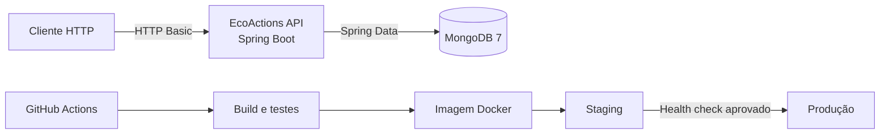
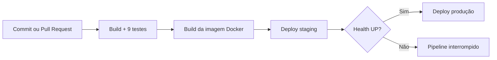
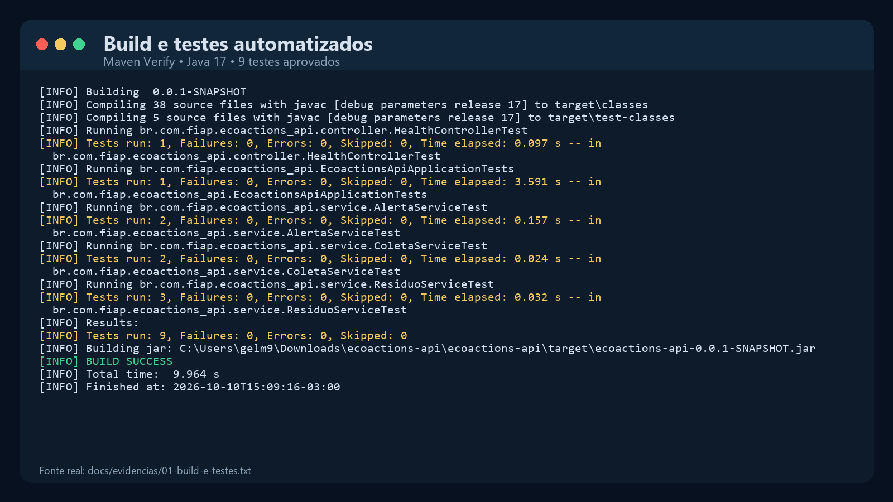
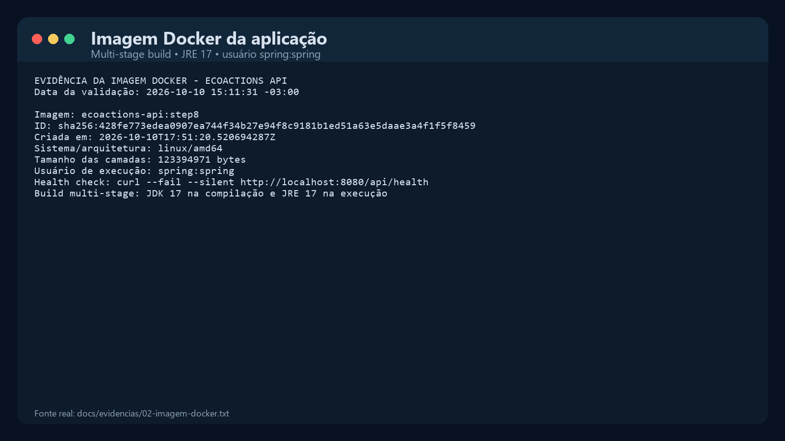
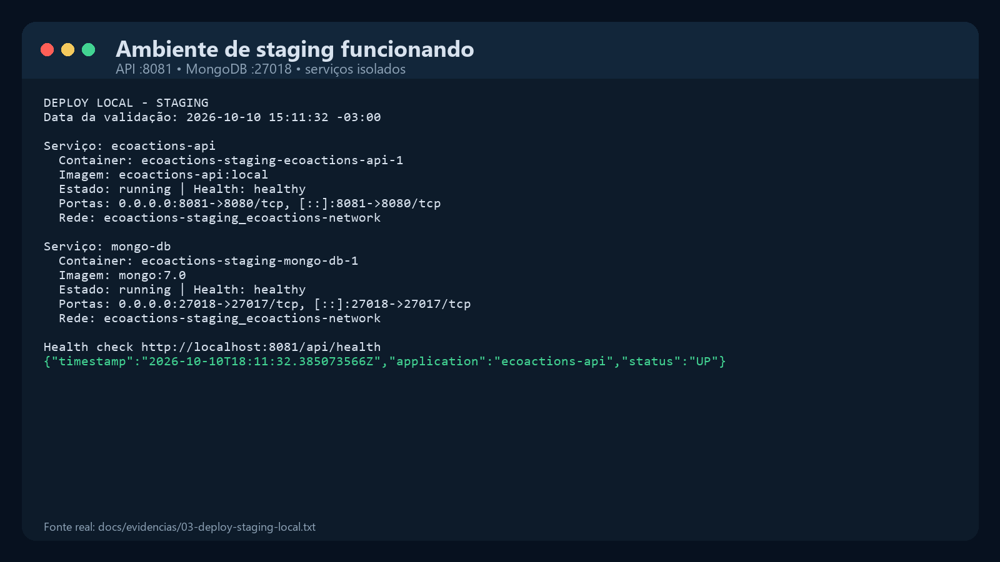
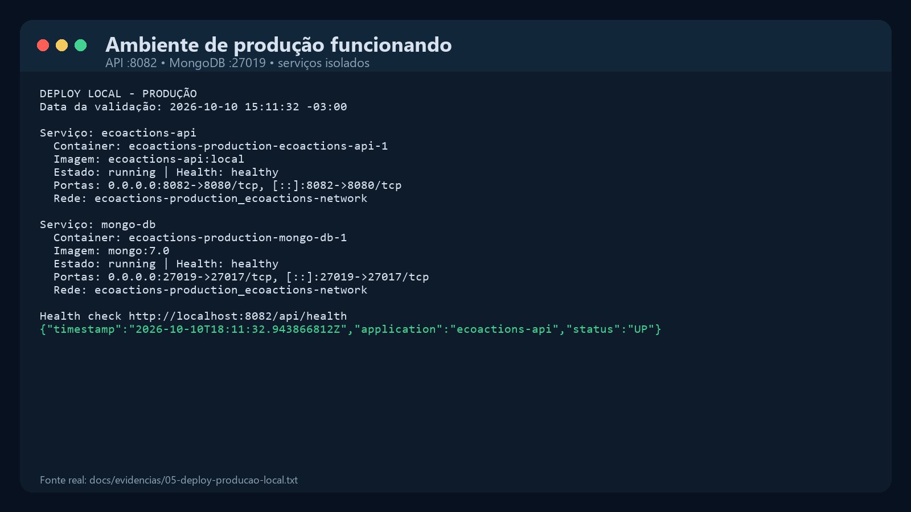
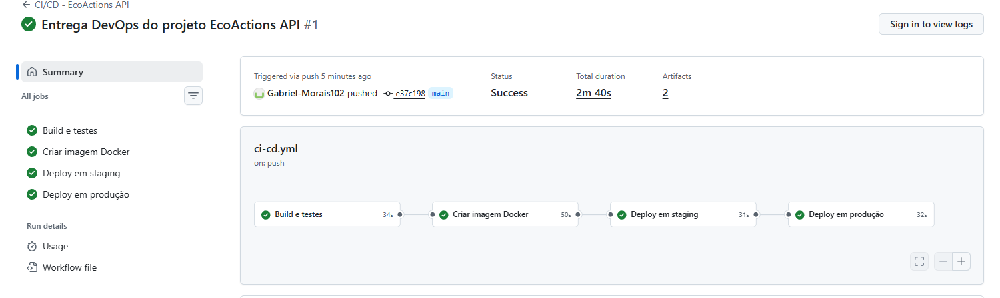
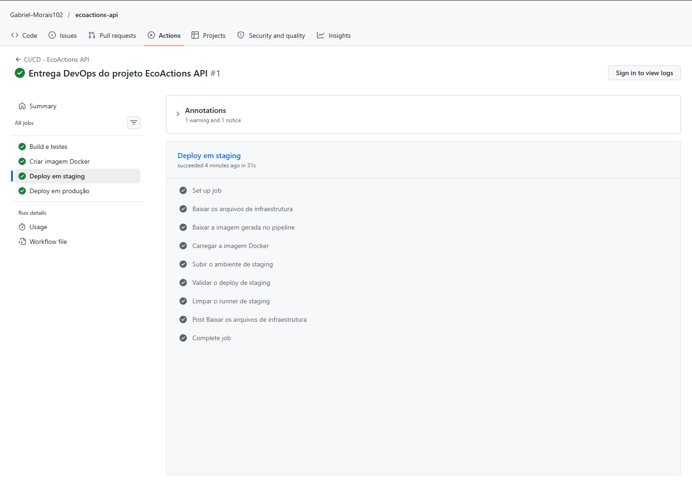
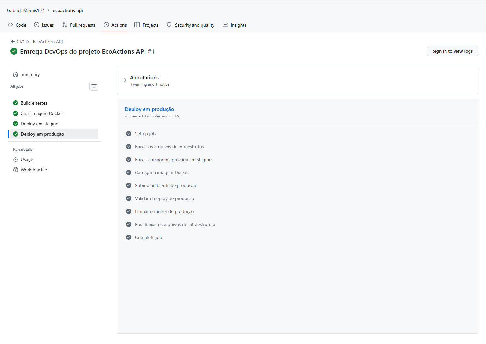

# Projeto — Cidades ESG Inteligentes | EcoActions API

API REST para apoiar a gestão inteligente de resíduos, pontos de coleta, coletas,
destinações e alertas ambientais. O projeto aplica práticas de DevOps para
automatizar build, testes, containerização e deploy em staging e produção.

**Repositório público:** [github.com/Gabriel-Morais102/ecoactions-api](https://github.com/Gabriel-Morais102/ecoactions-api)

> **Integrante(s):** preencher antes da entrega  
> **Turma:** preencher antes da entrega

## Sumário

- [Sobre o projeto](#sobre-o-projeto)
- [Arquitetura](#arquitetura)
- [Como executar localmente com Docker](#como-executar-localmente-com-docker)
- [Ambientes de staging e produção](#ambientes-de-staging-e-produção)
- [Pipeline CI/CD](#pipeline-cicd)
- [Testes automatizados](#testes-automatizados)
- [Containerização](#containerização)
- [Principais endpoints](#principais-endpoints)
- [Variáveis de ambiente](#variáveis-de-ambiente)
- [Prints do funcionamento](#prints-do-funcionamento)
- [Tecnologias utilizadas](#tecnologias-utilizadas)
- [Documentação técnica](#documentação-técnica)
- [Estrutura do projeto](#estrutura-do-projeto)
- [Checklist da entrega](#checklist-da-entrega)

## Sobre o projeto

O EcoActions foi desenvolvido para o contexto de cidades ESG inteligentes. A
aplicação registra informações relacionadas ao descarte de resíduos e permite
acompanhar o fluxo desde o ponto de coleta até a destinação final.

O domínio está dividido em cinco áreas:

- resíduos e seus limites de armazenamento;
- pontos de coleta;
- coletas realizadas;
- destinações dos materiais;
- alertas ambientais.

Os dados são persistidos no MongoDB. Na primeira inicialização, um script cria
as collections, índices e uma carga de demonstração com 10 documentos em cada
collection.

## Arquitetura



No ambiente Docker, a API e o MongoDB compartilham uma rede privada. Apenas as
portas necessárias são publicadas no computador. Os dados do MongoDB ficam em
um volume persistente e separado para cada ambiente.

## Como executar localmente com Docker

### Pré-requisitos

- Docker Desktop com Docker Compose;
- portas `8080` e `27017` disponíveis;
- Git, caso o projeto seja obtido por clone.

### 1. Configurar o ambiente

Na raiz do projeto, copie o arquivo de exemplo:

```powershell
Copy-Item .env.example .env
```

No Linux ou macOS, o comando equivalente é:

```bash
cp .env.example .env
```

Edite o arquivo `.env` e substitua as senhas marcadas com
`troque_esta_senha`. Esse arquivo não é versionado pelo Git.

### 2. Construir e iniciar os serviços

```bash
docker compose up --detach --build
```

O Compose inicia os serviços na ordem correta: primeiro o MongoDB, depois a
API. A aplicação só é iniciada quando o banco passa no health check.

### 3. Conferir o estado dos contêineres

```bash
docker compose ps
```

Os dois serviços devem aparecer com o estado `healthy`.

### 4. Testar a aplicação

Health check público:

```bash
curl http://localhost:8080/api/health
```

Resposta esperada:

```json
{"status":"UP"}
```

Consulta autenticada:

```bash
curl -u admin:SENHA_DEFINIDA_NO_ENV http://localhost:8080/api/residuos
```

A aplicação fica disponível em `http://localhost:8080` e o MongoDB em
`localhost:27017`.

### 5. Encerrar o ambiente

Para parar os serviços e preservar os dados:

```bash
docker compose down
```

Para também apagar o volume do banco e refazer a carga inicial no próximo
início:

```bash
docker compose down --volumes
```

> O segundo comando remove os dados armazenados no ambiente local.

## Ambientes de staging e produção

O mesmo `docker-compose.yml` é reutilizado com configurações diferentes. O nome
do projeto Compose garante redes, contêineres e volumes independentes.

| Ambiente | API | MongoDB | Projeto Compose | Banco |
| --- | --- | --- | --- | --- |
| Local | `localhost:8080` | `localhost:27017` | `ecoactions-local` | `ecoactions` |
| Staging | `localhost:8081` | `localhost:27018` | `ecoactions-staging` | `ecoactions_staging` |
| Produção | `localhost:8082` | `localhost:27019` | `ecoactions-production` | `ecoactions_production` |

Antes de iniciar staging ou produção, crie os arquivos locais e altere suas
senhas:

```powershell
Copy-Item deploy/staging.env.example deploy/staging.env
Copy-Item deploy/production.env.example deploy/production.env
```

Construa a imagem utilizada nos dois ambientes:

```bash
docker build --tag ecoactions-api:local .
```

Deploy de staging:

```bash
docker compose --env-file deploy/staging.env up --detach --no-build
```

Deploy de produção:

```bash
docker compose --env-file deploy/production.env up --detach --no-build
```

Os arquivos `deploy/*.env` são ignorados pelo Git. Apenas os modelos `.example`
fazem parte do projeto.

## Pipeline CI/CD

O pipeline foi implementado com GitHub Actions no arquivo
`.github/workflows/ci-cd.yml`.

Ele pode ser iniciado de três maneiras:

- pull request direcionado à branch `main`;
- push realizado na branch `main`;
- execução manual pela opção **Run workflow** do GitHub Actions.

### Fluxo do pipeline

| Job | Responsabilidade | Condição |
| --- | --- | --- |
| `build-and-test` | Configura Java 17, compila e executa os testes | Sempre |
| `docker-image` | Constrói e empacota a imagem Docker | Após build e testes |
| `deploy-staging` | Sobe staging e executa smoke test | Push em `main` ou execução manual |
| `deploy-production` | Sobe produção e executa smoke test | Somente após staging aprovado |



A imagem criada no job Docker é salva como artefato e reutilizada nos dois
deploys. Assim, produção recebe exatamente a mesma versão validada em staging.
Cada deploy consulta `/api/health`; produção não é executada se staging falhar.

Em pull requests, os deploys não são realizados: apenas build, testes e
construção da imagem são validados. No GitHub, os ambientes são identificados
como `staging` e `production`, permitindo adicionar aprovação manual ao ambiente
de produção, se desejado.

Nesta versão acadêmica, os jobs usam runners hospedados pelo GitHub. Os serviços
são iniciados, verificados e removidos ao final do job. Os comandos da seção
anterior permitem manter os ambientes ativos localmente com volumes persistentes.

## Testes automatizados

O projeto possui 9 testes automatizados, distribuídos entre:

- inicialização do contexto Spring Boot;
- resposta do endpoint de health check;
- regras de negócio de resíduos;
- regras de negócio de coletas;
- criação e tratamento de alertas.

Execução no Windows:

```powershell
.\mvnw.cmd --batch-mode --no-transfer-progress clean verify
```

Execução no Linux ou macOS:

```bash
./mvnw --batch-mode --no-transfer-progress clean verify
```

Os relatórios são gerados em `target/surefire-reports`. No pipeline, o JAR e os
relatórios ficam disponíveis como artefatos por sete dias.

## Containerização

### Dockerfile

```dockerfile
FROM eclipse-temurin:17-jdk-jammy AS build

WORKDIR /workspace

COPY mvnw .
COPY .mvn .mvn
COPY pom.xml .

RUN chmod +x mvnw && ./mvnw -B dependency:go-offline

COPY src src

RUN ./mvnw -B clean package -DskipTests

FROM eclipse-temurin:17-jre-jammy AS runtime

RUN apt-get update \
    && apt-get install -y --no-install-recommends curl \
    && rm -rf /var/lib/apt/lists/* \
    && groupadd --system spring \
    && useradd --system --gid spring spring

WORKDIR /app

COPY --from=build --chown=spring:spring \
    /workspace/target/ecoactions-api-0.0.1-SNAPSHOT.jar \
    app.jar

USER spring:spring

EXPOSE 8080

HEALTHCHECK --interval=30s --timeout=5s --start-period=30s --retries=3 \
    CMD curl --fail --silent http://localhost:8080/api/health || exit 1

ENTRYPOINT ["java", "-jar", "app.jar"]
```

### Estratégias adotadas

- **Multi-stage build:** o JDK e o Maven Wrapper ficam apenas na etapa de build;
- **Imagem de runtime menor:** a imagem final utiliza somente o JRE 17;
- **Cache de dependências:** o `pom.xml` é copiado antes do código-fonte;
- **Usuário não privilegiado:** a aplicação executa como `spring:spring`;
- **Health check:** o Docker verifica `/api/health` automaticamente;
- **Contexto reduzido:** o `.dockerignore` evita copiar arquivos desnecessários;
- **Testes separados:** o pipeline testa primeiro e só então constrói a imagem.

### Orquestração

O `docker-compose.yml` configura:

- API Spring Boot;
- MongoDB 7;
- rede dedicada `ecoactions-network`;
- volume persistente `mongo-data`;
- variáveis de ambiente;
- dependência baseada no health check do banco;
- health checks para banco e aplicação.

## Principais endpoints

| Método | Endpoint | Descrição | Acesso |
| --- | --- | --- | --- |
| `GET` | `/api/health` | Saúde da aplicação | Público |
| `GET` | `/api/residuos` | Lista resíduos | USER ou ADMIN |
| `POST` | `/api/residuos` | Cadastra um resíduo | ADMIN |
| `PUT` | `/api/residuos/{id}` | Atualiza um resíduo | ADMIN |
| `DELETE` | `/api/residuos/{id}` | Remove um resíduo | ADMIN |
| `GET` | `/api/pontos-coleta` | Lista pontos de coleta | USER ou ADMIN |
| `GET` | `/api/coletas` | Lista coletas | USER ou ADMIN |
| `GET` | `/api/destinacoes` | Lista destinações | USER ou ADMIN |
| `GET` | `/api/alertas` | Lista alertas | USER ou ADMIN |
| `POST` | `/api/alertas/verificar-ponto/{id}` | Verifica alertas de um ponto | ADMIN |

As demais operações CRUD seguem o mesmo padrão de autorização: consultas são
permitidas para `USER` e `ADMIN`; alterações são restritas ao `ADMIN`.

## Variáveis de ambiente

| Variável | Finalidade | Exemplo local |
| --- | --- | --- |
| `COMPOSE_PROJECT_NAME` | Nome e isolamento do projeto Compose | `ecoactions-local` |
| `APP_IMAGE` | Imagem da aplicação | `ecoactions-api:local` |
| `APP_PORT` | Porta publicada para a API | `8080` |
| `SERVER_PORT` | Porta interna do Spring Boot | `8080` |
| `MONGO_PORT` | Porta publicada para o MongoDB | `27017` |
| `MONGO_DATABASE` | Nome do banco do ambiente | `ecoactions` |
| `MONGO_ROOT_USERNAME` | Usuário administrador do MongoDB | definido no `.env` |
| `MONGO_ROOT_PASSWORD` | Senha do MongoDB | definida no `.env` |
| `MONGODB_AUTO_INDEX_CREATION` | Criação automática de índices | `true` |
| `APP_ADMIN_USERNAME` | Usuário administrativo da API | `admin` |
| `APP_ADMIN_PASSWORD` | Senha administrativa da API | definida no `.env` |
| `APP_USER_USERNAME` | Usuário de consulta da API | `user` |
| `APP_USER_PASSWORD` | Senha do usuário de consulta | definida no `.env` |

## Prints do funcionamento

As evidências abaixo foram produzidas a partir de execuções reais e possuem os
respectivos logs `.txt` em `docs/evidencias`. As imagens apresentam o conteúdo
dos logs de forma legível; não representam uma execução fictícia do GitHub.

### Build e testes



Resultado: `BUILD SUCCESS`, com 9 testes executados, nenhuma falha e nenhum erro.

### Imagem Docker



A imagem utiliza Linux `amd64`, runtime Java 17 e o usuário não privilegiado
`spring:spring`.

### Staging funcionando



Staging possui API na porta `8081`, MongoDB na porta `27018` e health check
com status `UP`.

### Produção funcionando



Produção possui API na porta `8082`, MongoDB na porta `27019` e health check
com status `UP`.

### Pipeline executado no GitHub Actions



A [execução #1 do workflow](https://github.com/Gabriel-Morais102/ecoactions-api/actions/runs/38076926404)
terminou com status **Success** em 2 minutos e 40 segundos. Os quatro jobs
foram executados em sequência: build e testes, criação da imagem Docker, deploy
em staging e deploy em produção.

#### Deploy em staging



#### Deploy em produção



## Tecnologias utilizadas

- Java 17;
- Spring Boot 3.5;
- Spring Web;
- Spring Data MongoDB;
- Spring Security;
- Bean Validation;
- JUnit 5 e Mockito;
- Maven Wrapper;
- MongoDB 7;
- Docker e Docker Compose;
- GitHub Actions;
- YAML, Bash e PowerShell.

## Documentação técnica

A apresentação técnica está disponível em
[`documentacao/EcoActions-Documentacao-Tecnica.pptx`](documentacao/EcoActions-Documentacao-Tecnica.pptx).
Ela reúne a arquitetura, o pipeline, as estratégias de containerização, as
evidências locais de build, testes e deploy, além dos desafios encontrados.

Os campos de integrantes e turma devem ser preenchidos antes do envio. A
apresentação já contém os prints da primeira execução real do GitHub Actions;
nenhuma evidência foi simulada.

## Estrutura do projeto

```text
ecoactions-api/
├── .github/
│   └── workflows/
│       └── ci-cd.yml
├── deploy/
│   ├── production.env.example
│   ├── staging.env.example
│   └── README.md
├── docker/
│   └── mongodb/
│       └── init/
│           └── 01-create-collections-and-crud.js
├── docs/
│   ├── assets/
│   └── evidencias/
├── documentacao/
│   └── EcoActions-Documentacao-Tecnica.pptx
├── src/
│   ├── main/
│   └── test/
├── .dockerignore
├── .env.example
├── .gitignore
├── docker-compose.yml
├── Dockerfile
├── mvnw
├── mvnw.cmd
├── pom.xml
└── README.md
```

## Checklist da entrega

O checklist reflete o estado do pacote gerado neste passo. Os itens relacionados
à execução do pipeline no GitHub devem ser revisados após a publicação do
repositório.

| Item | OK |
| --- | :---: |
| Projeto compactado em `.zip` com estrutura organizada | ☑ |
| Dockerfile funcional | ☑ |
| `docker-compose.yml` ou arquivos Kubernetes | ☑ |
| Pipeline com etapas de build, teste e deploy | ☑ |
| README.md com instruções e prints | ☑ |
| Documentação técnica com evidências em PDF ou PPT | ☑ |
| Deploy realizado nos ambientes staging e produção | ☑ |

Todos os itens técnicos foram concluídos e comprovados. Antes do upload na
plataforma, falta somente preencher os nomes e a turma nos campos indicados.
